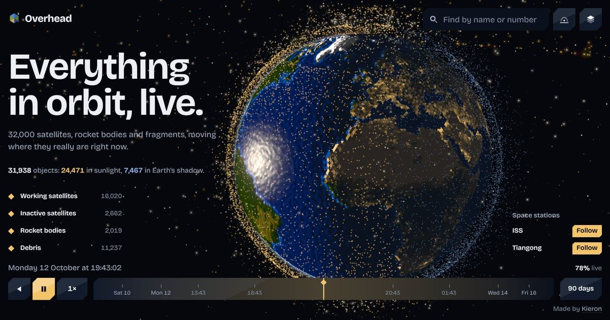

# Overhead

**Live at [overhead.kieronoates.workers.dev](https://overhead.kieronoates.workers.dev)**



Overhead is a live 3D globe of everything being tracked in orbit: around 32,000 satellites, rocket bodies and pieces of debris, each moving where it really is right now. You can scrub a week either way, pick out groups like Starlink or the space stations, ride along with the ISS, and see what's above you tonight and when the stations next pass over.

## Why I built it

The satellite trackers I used were either beautiful or useful, rarely both, and almost none of them worked well on a phone. I wanted to see everything in orbit at once, moving where it really is, and to be able to fly in close.

## How it works

A Cloudflare Worker collects the latest published orbits every two hours and keeps them in KV. It streams them to the browser without parsing them. Everything else happens on your device. A web worker runs SGP4 (satellite.js, compiled to WASM) to anchor each orbit, the vertex shader moves all 32,000 objects along their orbits every frame, and picking, search and the pass predictions run in workers off the main thread. Brightness is estimated from each object's radar cross-section, since the usual magnitude lists can't be redistributed.

## Running it locally

You'll need Node 24.

```sh
npm ci

# Optional: a Space-Track login for the full catalogue. Without one, the Worker falls back to
# CelesTrak's list of active satellites, which has no debris or rocket bodies.
printf 'SPACETRACK_USER=you@example.com\nSPACETRACK_PASS=your-password\n' > .dev.vars

# The Worker, on localhost:8787
npx wrangler dev --port 8787 --test-scheduled

# In another terminal: fill the local store once, then start the site on localhost:5173
curl "http://localhost:8787/cdn-cgi/handler/scheduled?cron=17+*/2+*+*+*"
npm run dev
```

Both data sources ask not to be polled more than every couple of hours, so run the refresh sparingly.

To deploy, `npm run build` then `npx wrangler deploy`, with `SPACETRACK_USER` and `SPACETRACK_PASS` added to the Worker as secrets.

## Built with

Svelte 5 and TypeScript, bundled with Vite. Three.js with custom GLSL for the globe, satellite.js for SGP4, camera-controls and postprocessing. A Cloudflare Worker with static assets, KV and a cron trigger.

## Credits

- **Orbital data:** USSPACECOM via [Space-Track.org](https://www.space-track.org), and [CelesTrak](https://celestrak.org).
- **Earth:** NASA Earth Observatory's Blue Marble Next Generation and Black Marble, GEBCO elevation via NASA Earth Observatory, and [Natural Earth](https://www.naturalearthdata.com) land outlines.
- **Place names:** [GeoNames](https://www.geonames.org), CC BY 4.0. The town lists in `public/places/` are derived from it.
- **Stars:** the [HYG database](https://github.com/astronexus/HYG-Database), CC BY-SA 4.0. `public/stars.json` is derived from it and shared under the same licence.
- **ISS model:** NASA.
- **Typeface:** Bricolage Grotesque, SIL Open Font License 1.1, via Fontsource.
- **Libraries:** Svelte (MIT), three.js (MIT), satellite.js (MIT), camera-controls (MIT) and postprocessing (Zlib).

## Licence

The code is MIT licensed (see `LICENSE`). The data and imagery above remain under their own terms.
